<p align="center">
  
</p>

<h1 align="center">RM Engine</h1>

<p align="center">
  <b>プラグインで形を変える、クリエイターのための制作ソフト</b><br>
  A plugin-driven creative suite for Windows, written from scratch in C++20.
</p>

<p align="center">
  C++20 ・ Direct3D 11 / Direct2D / DirectWrite ・ Windows 10 / 11 ・ Visual Studio 2022 ・ v0.0.2
</p>

---

## これは何か

RM Engine は、**ゲーム制作を中心に、イラスト・作曲・3D モデルなどの「ソフト」をプラグインで足していく**ための制作ソフトです。
エンジンの核は小さく保ち、ゲーム制作も 3D も物理も音も、すべてプラグインとして作っています。

UI ライブラリ (ImGui など) やゲームエンジンは使わず、**ウィンドウ・UI・描画・データの仕組みまで自作**しています。

## 見どころ

### 1. 自作の UI (ImGui を使わない)
- 入力・フォーカス・文字入力 (IME)・描画を持つ**土台**と、見た目の**部品**を分けた 2 層の作り
- **変わったときだけ描き直す**ので、何もしていないときの CPU はほぼ 0
- パネルのドッキング (分割・タブ・**別ウィンドウへ切り離し**)、黒 / 白のテーマとテーマパック、日本語 / English の切り替え

### 2. プラグインで形を変える
- 核 (`src/`) は**プラグインを知らない**。ソフト・部品・システム・描画は、すべてプラグインが「口」に差し出す
- ゲーム制作は 3D も 2D も知らない。両方を知る部分は**つなぎのプラグイン** (「ゲーム制作 × 3D」など) に置き、依存が一方向になるようにした
- 層の柵 (`layers.txt`) を**ビルドのたびにスクリプトで検査**し、ゲームに入る層がエディターを読めないようにしている

### 3. データの型を 1 か所に書くだけ (リフレクション + コード生成)
- `RM_STRUCT` / `RM_PROPERTY` で型を書くと、自作のコード生成ツール **`rmgen`** がビルドのたびに型の表を作る
- **保存 (JSON)・読み込み・インスペクター・Undo・範囲のチェック**がすべてそこから出る。手で書き足す所が無い
- 保存形式は自己記述型の JSON。**知らないキーは捨てずに書き戻す** (新旧の版の間でデータが失われない)

### 4. ゲーム制作
| 分野 | 中身 |
|---|---|
| シーン | エンティティと部品 (ECS)・階層・Prefab・Play (シーンのコピーを動かす)・Undo |
| 3D 描画 | Direct3D 11。PBR 風の光・カスケードの影・空 (パノラマ / 6 面)・glTF / OBJ / FBX の取り込み (座標系と単位を選べる)・左手系 (Y が上) |
| 2D 描画 | Direct2D。スプライト (アトラス)・アニメーション |
| 天候 | 雲・雨・雪・霧を 0〜100 で。**雨の染み・雪の積もり (高さのある層)・歩いた跡が残る**・風向きで屋根の下へ吹き込む |
| パーティクル | **GPU (Compute Shader)** で動かす。モジュールの HLSL を 1 本のシェーダーに組み立てる |
| 物理 | Jolt Physics (剛体・当たり判定・キャラクター) |
| 音 | XAudio2 / X3DAudio。WAV・OGG・MP3 などを読み、長い音は流して再生 |
| ゲーム UI | キャンバス・アンカー・文字・画像 (9 スライス)・ボタン・バー |
| C++ スクリプト | ゲームのコードは **C++ の DLL**。保存するとビルドして**ホットリロード** (値を引き継ぐ)。エンジンとの境目は C だけの ABI |
| 書き出し | エディターを含まないゲームの exe を作る。アセットは AES-256 (Windows CNG) で暗号化した `.rmpak` に |

### 5. 品質の守り方
- **496 個のテスト (13,000 以上の確かめ)** を、ビルドのたびに全部走らせる (純粋な計算は I/O と描画から離してテストする)
- 警告レベル `/W4` で**警告 0** を保つ
- 層の柵・画面の文字の翻訳漏れも、スクリプトがビルドのたびに止める
- 前に作ったエンジンの失敗から決めた **10 条の「憲法」** ([CLAUDE.md](CLAUDE.md)) を守って作っている

## 技術

| 分類 | 使っているもの |
|---|---|
| 言語 | C++20 (`/W4`・`/utf-8`) |
| 描画 | Direct3D 11 (HLSL・Compute Shader)・Direct2D・DirectWrite |
| OS | Win32 API・WIC・Media Foundation・XAudio2・CNG (暗号・SHA-256) |
| 外部ライブラリ | Jolt Physics (物理。MIT)・stb_vorbis (OGG) |
| ビルド | Visual Studio 2022 / MSBuild・PowerShell のスクリプト・自作のコード生成 `rmgen` |

## 作り (層)

```
src/
  base/       L0  文字列・UTF-8・JSON・ログ (標準ライブラリだけ)
  core/       L2  Undo・リフレクション・アセットの ID・プラグインの ID
  platform/   L3  Win32 ウィンドウ・D3D11 / D2D・ファイル・暗号
  ui/         L4  UI の土台 (入力・フォーカス・文字入力・描画。色を持たない)
  game/       L5  書き出したゲームの枠 (エディターを含まない)
  editor/     L6  Hub・エディターの枠・見た目の部品・インスペクター・ドッキング
plugins/rm_engine/
  game_production   ゲーム制作 (シーン・部品・Play・スクリプト・Prefab)
  space3d / space2d 3D / 2D の空間と描画
  game_x_3d / game_x_2d / game_x_audio / game_x_particles   つなぎのプラグイン
  physics / audio / particles / weather / game_ui           機能のプラグイン
  theme_*           テーマパック
tests/        テスト (RMTests.exe)
tools/        ビルド・層の検査・翻訳の検査・rmgen
```

数字の小さい層は、大きい層を読めません。ゲームに入る層 (`base`〜`game` と、プラグインの `runtime/`) は、エディターを読めません。

## ビルド

Windows 10 / 11 と、Visual Studio 2022 (「C++ によるデスクトップ開発」) が要ります。

```powershell
powershell -NoProfile -ExecutionPolicy Bypass -File tools\build.ps1 -Config Release
```

ビルド → テスト → 層の検査 → 翻訳の検査の順に走ります。できた exe は `build\bin\x64\Release\RM_Engine.exe` です。`RM_Engine.sln` を Visual Studio で開いてもビルドできます。

## これから

- **プラグインの配布**: エンジン本体だけを配り、プラグインはダウンロードして入れる形に ([設計](docs/PLUGIN_DISTRIBUTION.md))。DLL の境目は Godot の GDExtension と同じ「C の境目 + C++ の包み」
- アニメーション (状態のグラフ)・UI エディター
- イラスト・作曲・3D モデルのソフト

## ドキュメント

| 文書 | 中身 |
|---|---|
| [docs/ARCHITECTURE.md](docs/ARCHITECTURE.md) | 全体の設計と、決めたこと |
| [docs/TECHNOLOGIES.md](docs/TECHNOLOGIES.md) | 使った技術の説明 |
| [docs/PLUGIN_DISTRIBUTION.md](docs/PLUGIN_DISTRIBUTION.md) | プラグインの配布の設計 |
| [docs/HOW_TO_TRY.md](docs/HOW_TO_TRY.md) | 機能ごとの試し方 |
| [plugins/README.md](plugins/README.md) | プラグインの作りと決まり |

## 作者

**ir-cola** — ポートフォリオ: https://ir-cola.github.io/
